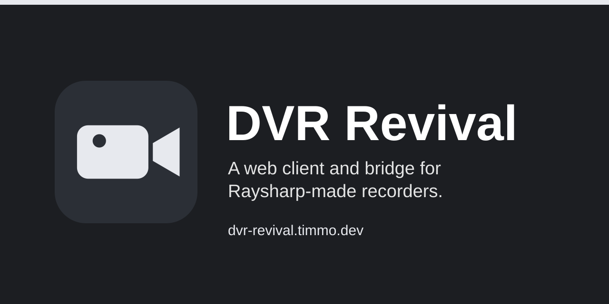

# Kestrel



One app for your cameras and recorders: live view, recordings, events and
each one's health, from any browser or as an app on your phone. It talks to
each system directly, through a small server on your own network, so nothing
goes through a vendor's cloud and old hardware stays useful after its own apps
stop working.

## What it works with

- **Raysharp-made recorders**, such as the Swann DVR8-4575, which are sold
  under several brands. Their own apps and browser plugins no longer work in
  modern browsers.

On the way, each behind the same pages:

- Reolink cameras ([#12](https://github.com/timmo001/kestrel/issues/12))
- the camera in a Bambu Lab printer
  ([#13](https://github.com/timmo001/kestrel/issues/13))
- any camera with a stream address
  ([#14](https://github.com/timmo001/kestrel/issues/14))
- recording any of them itself
  ([#15](https://github.com/timmo001/kestrel/issues/15))

## What it does

- **Live:** every camera in 1 to 4 at once, with its own controls.
- **Recordings:** a day's timeline, with several channels played together on
  one clock, playback up to 32 times, clips, stills and MP4 downloads.
- **Events:** motion, PIR and alarms as they happen.
- **Health:** whether each system is reachable, its disks and each camera's
  signal, with problems pushed to your phone.
- **For agents:** the `kestrel` CLI, with Code Mode and MCP.

The server runs [go2rtc](https://github.com/AlexxIT/go2rtc) for the video, and
the pages are built on [Groundwork](https://github.com/timmo001/groundwork).

## Running it

You need [mise](https://mise.jdx.dev). Copy `.env.example` to `.env.local` and
fill in your recorder's address and login, then:

```sh
mise install
mise run build
mise run serve:server
```

Open <https://server.kestrel.localhost>. The docs in [`docs/`](docs) cover
the settings, the API and the protocol.

The server has no login and listens on `127.0.0.1` by default, so only open it
up to a network where everyone who can reach it should see your cameras. A
login is planned for when remote access arrives, in
[timmo001/kestrel#19](https://github.com/timmo001/kestrel/issues/19).

## Parts

- [`packages/core`](packages/core): what every source shares: how sources
  and cameras are named, what they report and the interface each kind
  implements, in TypeScript with [Effect](https://effect.website)
- [`packages/protocol-raysharp`](packages/protocol-raysharp): the Raysharp
  recorders' control protocol
- [`packages/source-raysharp`](packages/source-raysharp): Raysharp recorders
  as a source, over that protocol and their RTSP streams
- [`packages/source-stream`](packages/source-stream): cameras you list by
  their stream addresses, such as RTSP, or a still picture, for live view
- [`packages/server`](packages/server): the server, with the API and go2rtc
- [`packages/web`](packages/web): the web client, installable on a phone
- [`packages/cli`](packages/cli): the `kestrel` CLI, with Code Mode and
  MCP for agents, and its [skill](skills/kestrel/SKILL.md)
- [`docs`](docs): the docs site

## Developing

```sh
mise run check   # lint, types, formatting and the docs
mise run test
```

Where it's heading is in
[timmo001/kestrel#11](https://github.com/timmo001/kestrel/issues/11).
